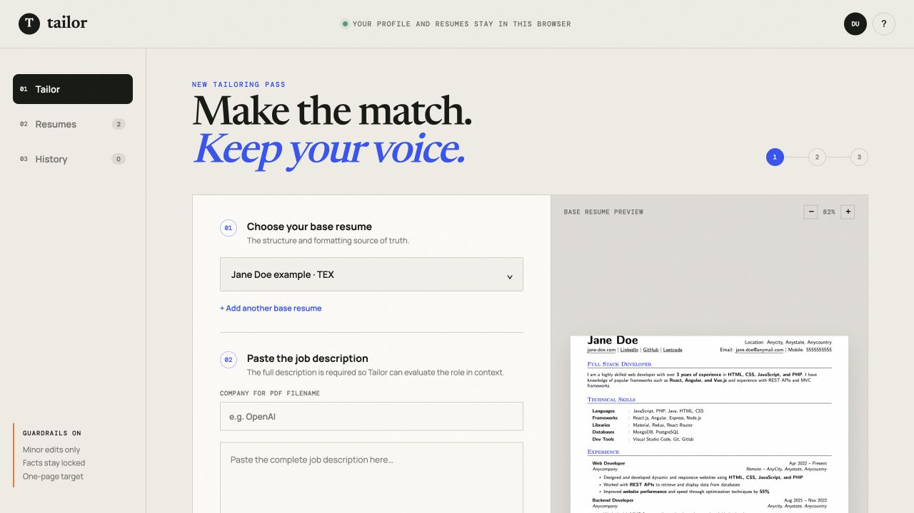

# Tailor

Tailor is a browser-based resume tailoring tool for people who keep their resumes in LaTeX. I built it because most resume tools flatten carefully designed layouts, make broad rewrites, or optimize for keywords without showing what changed.

Tailor keeps the original LaTeX source as the formatting source of truth. It reads a pasted job description, proposes evidence-backed wording changes, asks before adding skills that are not already explicit, and compiles the revised source into a one-page PDF.

## Try it

[Open Tailor](https://sanjananagwekar.github.io/tailor-resume/)

[](https://sanjananagwekar.github.io/tailor-resume/)

The hosted version runs entirely in the browser. You can load either included example resume to try the workflow without using your own information.

## What it does

- Maintains a local library of LaTeX base resumes
- Includes two attributed, MIT-licensed sample resumes for trying the workflow
- Compiles the original source for an accurate in-browser preview
- Analyzes a complete, pasted job description
- Shows every proposed wording change before it is included
- Requires confirmation before adding implied skills or experience wording
- Displays match scores before and after accepted edits
- Preserves the original section order and LaTeX layout
- Downloads `Resume_First_Last_Company.pdf`

## How the match score works

Tailor reports a job-specific estimate with two visible components:

- **Job terms and close equivalents (up to 50%)** checks whether important requirements from the role are represented in the resume, including limited aliases such as `REST API` and `RESTful API`.
- **Evidence-backed responsibilities (at least 50%)** checks the strength of action-oriented resume evidence related to the role's priorities. A weak one-word connection receives less credit than a bullet containing several relevant details.

The analyzer excludes common benefits, compensation, privacy, and equal-opportunity boilerplate before identifying role requirements. It matches complete terms rather than arbitrary substrings, normalizes ordinary grammatical variants such as `owned` and `owning`, and limits any one matched term to at most five score points. The final resume is rescored after every accepted change using the same parsed representation as the original. Accepting an edit does not increase the score by itself. Tailor's score is designed as an explainable comparison tool, not as a score produced by an employer's ATS or a prediction of an interview.

## Privacy model

Tailor is a static application. Your profile, LaTeX sources, and saved tailoring history are stored in your browser using `localStorage`. There is no Tailor account server, password, analytics pipeline, or resume upload API.

The app loads PDF.js and LaTeX compiler resources from pinned external CDNs. Those resources are required to compile and preview PDFs, but Tailor does not send resume contents to them.

## Run locally

Requirements: Node.js 20 or newer.

```bash
npm run dev
```

Open `http://localhost:4174`.

## Run tests

```bash
npm test
```

The current tests cover role analysis, evidence-backed edits, unsupported-experience guardrails, approval candidates, boilerplate removal, grammatical variants, and before-and-after scoring.

## Project structure

```text
public/                  Static application served by GitHub Pages
  examples/              MIT-licensed sample LaTeX resumes
  latex/                 LaTeX compatibility files used by the compiler
  vendor/                Browser LaTeX compiler runtime
tests/                   Tailoring-engine regression tests
scripts/serve.js         Dependency-free local development server
.github/workflows/       Tests and GitHub Pages deployment
```

## Current limitations

- Base resumes must be LaTeX `.tex` files.
- Job descriptions must be pasted into the application.
- Browser storage is local to one browser and device.
- Tailor supports common resume templates, but unusual custom LaTeX macros may need additional parsing support.
- The match score is an internal estimate, not a score from a specific applicant tracking system.

## Author

Created and maintained by Sanjana Nagwekar.

## License

Tailor is available under the MIT License. Third-party components retain their original licenses; see [THIRD_PARTY_NOTICES.md](THIRD_PARTY_NOTICES.md).

